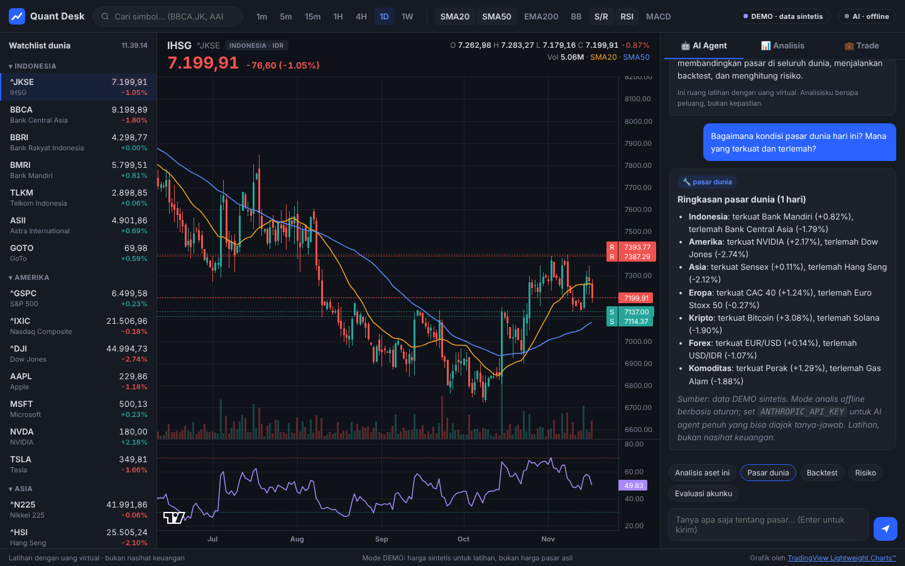

# Quant Desk

Platform **latihan investasi** dengan tampilan ala TradingView: grafik candlestick live, watchlist pasar dunia,
indikator teknikal, AI agent analis pasar, backtest, Monte Carlo, dan paper trading (uang virtual Rp 10 juta).
Edukasi, bukan nasihat keuangan.



## Menjalankan
```bash
pip install -r requirements.txt
python run.py            # data pasar asli (butuh internet)
python run.py --demo     # data sintetis, jalan offline
```
Browser akan terbuka di http://localhost:8000.

### Mengaktifkan AI agent (Claude)
Buat API key di https://console.anthropic.com, salin `.env.example` menjadi `.env`, lalu isi:
```
ANTHROPIC_API_KEY=sk-ant-...
```
File `.env` sudah ada di `.gitignore`, jadi tidak ikut ter-upload ke GitHub.
Opsional: `ANTHROPIC_MODEL` (default `claude-sonnet-5-5`). Pemakaian API berbayar per token.
Tanpa key, panel AI tetap jalan sebagai **analis offline berbasis aturan**.

AI agent memanggil alat-alat Quant Lab sendiri (analisis teknikal, pasar dunia, backtest, Monte Carlo,
ukuran posisi, isi akunmu) sehingga angkanya berasal dari data, bukan karangan. Ia tahu aset & interval yang sedang
kamu buka. Ia **tidak** punya akses berita/fundamental.

## Sumber data
| Pasar | Sumber | Keterangan |
|---|---|---|
| Kripto (BTC, ETH, SOL, …) | Binance | real-time, update ±2 detik |
| Saham IDX, AS, Asia, Eropa, indeks, forex, komoditas | Yahoo Finance (yfinance) | biasanya **tertunda 15–20 menit**, update tiap 15 detik |
| Mode `--demo` / saat sumber gagal | sintetis | badge ungu "DEMO", bukan harga asli |

Grafik memakai **TradingView Lightweight Charts™** (library open-source resmi TradingView). Data feed TradingView
sendiri tidak tersedia untuk aplikasi pribadi, jadi harga diambil dari Binance/Yahoo. Badge di kanan atas selalu
menunjukkan sumber data yang sedang dipakai.

Simbol Yahoo apa pun bisa diketik di kotak pencarian (mis. `UNVR.JK`, `7203.T`, `0700.HK`, `SAP.DE`).

## Fitur
- **Grafik**: candlestick + volume, interval 1m–1W, SMA20/50, EMA200, Bollinger, RSI & MACD di pane terpisah,
  garis support/resistance otomatis, penanda beli/jual dari jurnalmu, legend OHLC saat hover. Update live via WebSocket.
- **Watchlist dunia**: 37 aset di 7 kelompok, harga berkedip saat berubah.
- **Analisis**: bias teknikal, checklist, indikator, S/R, risiko (VaR/CVaR, rezim volatilitas, stop 2×ATR),
  backtest 4 strategi setelah biaya, simulasi Monte Carlo.
- **Trade**: akun virtual dalam Rupiah. Aset berdenominasi USD/JPY/EUR/… dikonversi dengan kurs terakhir.
  Tombol "Ukuran 1%" menghitung unit agar kena stop = rugi 1% akun. Alasan wajib diisi → jurnal trading.

## Struktur
    quantlab/          mesin kuant (backtest, metrik, risiko, portofolio, Monte Carlo, paper account)
    web/providers.py   data Binance / Yahoo / demo + kurs
    web/analysis.py    analisis teknikal & statistik
    web/agent.py       AI agent (Claude tool-use) + analis offline
    web/server.py      FastAPI: REST, WebSocket live, SSE untuk chat
    web/static/        frontend (HTML/CSS/JS + Lightweight Charts)
    app.py             dashboard Streamlit versi sebelumnya (mode Replay)
    tests/             28 tes (pytest)

## Catatan jujur
Indikator dan sinyal menggambarkan masa lalu. Tidak ada sistem yang bisa menjamin profit. Pakai ini untuk melatih
proses: analisis → rencana (entry, stop, ukuran) → eksekusi → jurnal → evaluasi.
